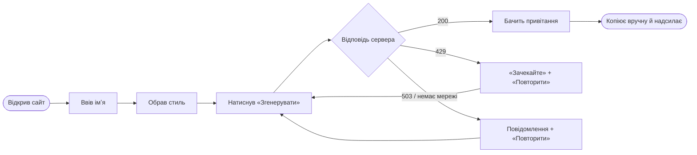

# MVP і пріоритети

## Розкладка вимог за MoSCoW

| ID | Вимога | MoSCoW | Версія | Статус |
|---|---|---|---|---|
| FR-01 | Форма з імʼям | Must | v0.1.0 | ✅ реалізовано |
| FR-02 | Вибір стилю гумору | Must | v0.1.0 | ✅ реалізовано |
| FR-03 | Генерація привітання | Must | v0.1.0 | ✅ реалізовано |
| FR-06 | Помилка й «Повторити» | Must | v0.1.0 | ✅ реалізовано |
| FR-10 | Стан завантаження | Must | v0.1.0 | ✅ реалізовано |
| FR-04 | Перегенерувати | Should | v0.2.0 | заплановано |
| FR-05 | Інтереси іменинника | Should | v0.2.0 | заплановано |
| FR-09 | Повідомлення про ліміт з таймером | Should | v0.1.0 / v0.2.0 | ⚠️ частково: повідомлення є, таймера немає |
| FR-14 | Оцінка 👍/👎 | Should | v0.3.0 | заплановано |
| FR-15 | Автоматична повторна генерація | Should | v0.2.0 | заплановано |
| FR-07 | Копіювати | Should | v0.3.0 | заплановано |
| FR-16 | Сторінка «Про сервіс» | Should | v0.3.0 | заплановано |
| FR-11 | Довжина привітання | Could | v0.4.0 | якщо встигнемо |
| FR-12 | «Жорсткість» гумору | Could | v0.4.0 | якщо встигнемо |
| FR-13 | Власний інтерес | Could | v0.4.0 | якщо встигнемо |
| FR-17 | Зворотний звʼязок | Could | v0.4.0 | якщо встигнемо |
| FR-08 | Посилання-листівка | Won't | після v1.0 | у [roadmap.md](../5-management/roadmap.md) |
| FR-18 | Мова привітання | Won't | після v1.0 | у [roadmap.md](../5-management/roadmap.md) |

Підсумок: Must — 5, Should — 7, Could — 4, Won't — 2.

## Межа першого релізу

**MVP (v0.1.0) = усі Must: FR-01, FR-02, FR-03, FR-06, FR-10.** Плюс NFR-4 (503 замість білого екрана) і CORS із NFR-6.

**v1.0.0 = Must + Should.** Could — якщо залишиться час; Won't — свідомо поза релізом.

Чому межа саме тут: без FR-01–FR-03 немає продукту, без FR-06 і FR-10 користувач бачить «зависання» чи білий екран і не повертається. Усе інше покращує привітання, але сценарій «отримати привітання» працює й без нього.

## Шлях користувача в MVP

Екрани кожного кроку — у [prototype/](../2-architecture/prototype/README.md).
