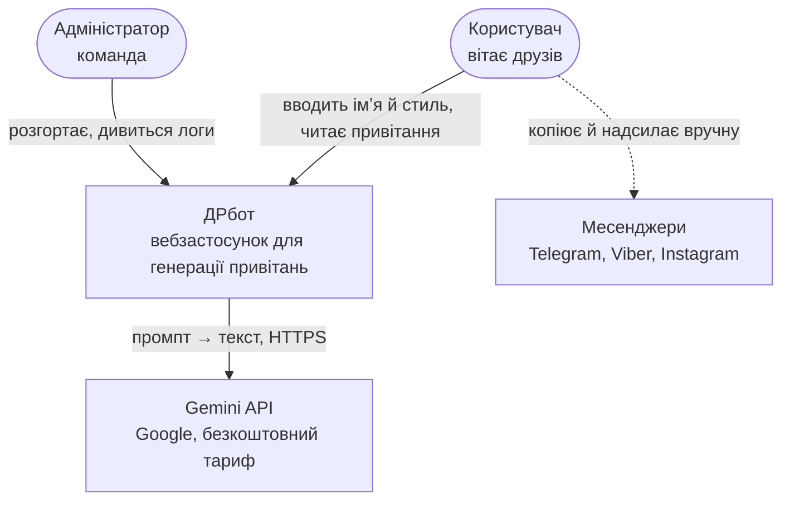
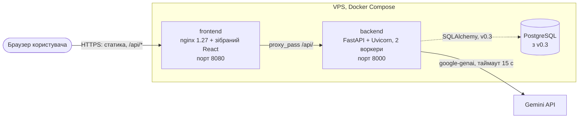
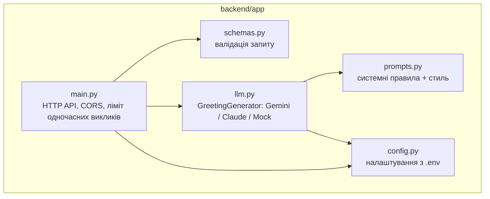

# Архітектура

## Архітектурний стиль

**Клієнт-серверний, багаторівневий (3 рівні):** односторінковий React-клієнт → REST API на FastAPI → зовнішній LLM-сервіс (і з v0.3 — PostgreSQL).

| Варіант | Чому ні / так |
|---|---|
| Монолітний (серверний рендеринг) | простіше, але інтерфейс зі станами завантаження й помилок зручніше робити на клієнті; гірше відділяється статика |
| **Клієнт-серверний, 3 рівні** | ✅ статика віддається nginx і не навантажує бекенд; ключ LLM лишається на сервері; API можна тестувати окремо |
| Мікросервісний | надмірно для 2–3 людей і одного сценарію; вузьке місце — ліміти LLM, а не сервер |
| Лише фронтенд із викликом LLM з браузера | ключ API потрапив би в браузер — неприйнятно |

Рішення зафіксовано в [ADR-0001](adr/0001-client-server-spa-api.md).

## C4, рівень 1 — контекст

## C4, рівень 2 — контейнери

## Компоненти бекенду

Детально модулі та їхні операції — у [modules.md](modules.md), контракт — у [api.md](api.md).

## Ключові властивості

| Властивість | Як забезпечено |
|---|---|
| Ключ API не потрапляє в браузер | виклик LLM лише з бекенду; ключ у `backend/.env`, який не комітиться |
| Сторінка не «білий екран» при збоях (NFR-4) | помилки LLM → 503/429 з поясненням; фронтенд показує повідомлення й «Повторити» |
| Заміна провайдера (NFR-9) | інтерфейс `GreetingGenerator`; провайдер обирається змінною `LLM_PROVIDER` ([ADR-0002](adr/0002-llm-provider-gemini.md)) |
| Захист від перевантаження (NFR-8) | асинхронні виклики + ліміт одночасних викликів LLM, надлишок → 429 ([ADR-0004](adr/0004-concurrency-limit-429.md)) |

## Масштабування

Розрахунок навантаження ([srs.md](../1-lifecycle/srs.md), розділ 7): навіть у стрес-сценарії це ≈ 2 генерації на секунду — дрібниця для FastAPI. **Вузьке місце — ліміти й час відповіді LLM API**, тому:

1. **Вертикально достатньо:** один VPS 1–2 vCPU, 2 ГБ RAM. Горизонтальне масштабування не допоможе, якщо впираємось у ліміт провайдера.
2. **Ліміт одночасних викликів** має бути спільним для всіх воркерів. Зараз він на кожен процес окремо (BUG-04) — при 2 воркерах фактично 40 замість 20. Виправлення: лічильник у Redis або один воркер.
3. **Довгі відповіді LLM** (до 14 с на `gemini-3.8-flash`, BUG-03) — легша модель або стрімінг SSE, щоб перші слова зʼявлялися за 1–2 с.
4. **Більше ніж 1 VPS** знадобиться лише після переходу на платний тариф LLM із вищими лімітами; тоді — кілька контейнерів `backend` за nginx і спільний Redis для лімітів.

## Розширення

| Що додаємо | Де змінюється |
|---|---|
| Новий стиль гумору | `Style` + `STYLE_HINTS` у `prompts.py`, кнопка в `STYLES` у `App.jsx` |
| Новий LLM-провайдер | новий клас у `llm.py` + гілка в `make_generator` |
| Інтереси, довжина, «жорсткість» | поля в `GreetingRequest`, рядки в промпті, елементи форми |
| Збереження й статистика | модуль сховища M6 + міграції Alembic ([ADR-0003](adr/0003-no-database-in-mvp.md)) |
| Листівка | новий ресурс `/api/cards` і маршрут фронтенду |
