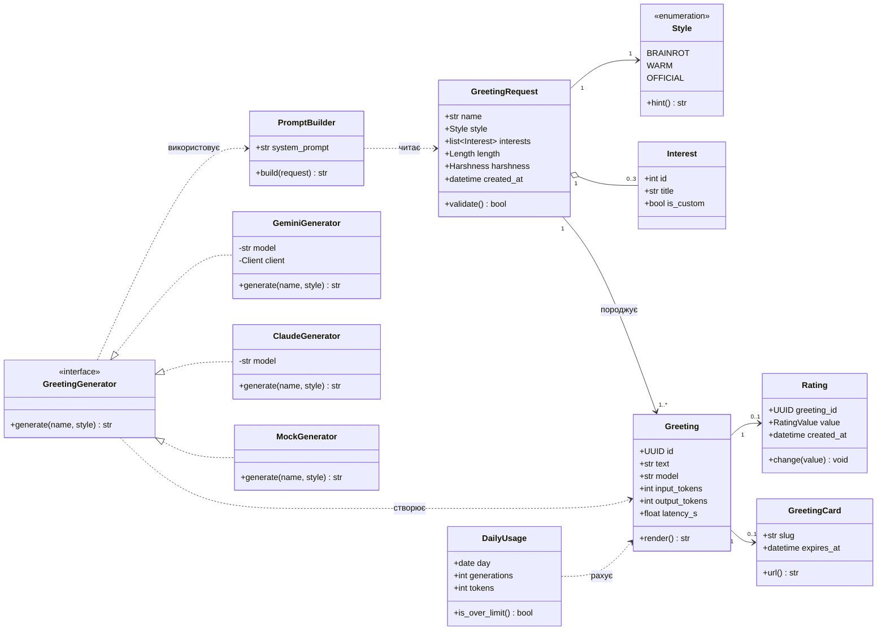

# Діаграма класів предметної області

Імена класів англійською — як у коді; пояснення українською в таблиці нижче. Класи з позначкою «v0.2+» ще не реалізовані.

| Клас | Що означає | Реалізовано |
|---|---|---|
| `GreetingRequest` | Запит на привітання: імʼя, стиль, інтереси, налаштування | частково: `name`, `style` (`backend/app/schemas.py`) |
| `Style` | Стиль гумору з інструкцією для LLM | ✅ `Style`, `STYLE_HINTS` |
| `Interest` | Інтерес іменинника зі списку або власний | v0.2 |
| `Greeting` | Згенерований текст і метадані виклику | частково: `GreetingResponse` (`text`, `style`) |
| `Rating` | Оцінка 👍/👎 | v0.3 |
| `GreetingCard` | Сторінка-листівка з коротким посиланням | Won't (після v1.0) |
| `PromptBuilder` | Збирає промпт із правилами безпеки й стилем | ✅ `build_user_prompt`, `SYSTEM_PROMPT` |
| `GreetingGenerator` | Інтерфейс генератора: один метод `generate` | ✅ `Protocol` у `backend/app/llm.py` |
| `GeminiGenerator`, `ClaudeGenerator`, `MockGenerator` | Реалізації для Gemini, Claude і заглушки | ✅ |
| `DailyUsage` | Лічильник генерацій і токенів на добу (NFR-2) | v0.3 |

Звʼязки: запит породжує одне або кілька привітань (кожна перегенерація — нове), привітання може мати одну оцінку й одну листівку. Генератор залежить від інтерфейсу, а не від конкретного провайдера — це забезпечує NFR-9.
