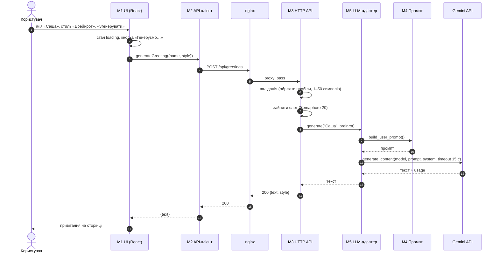
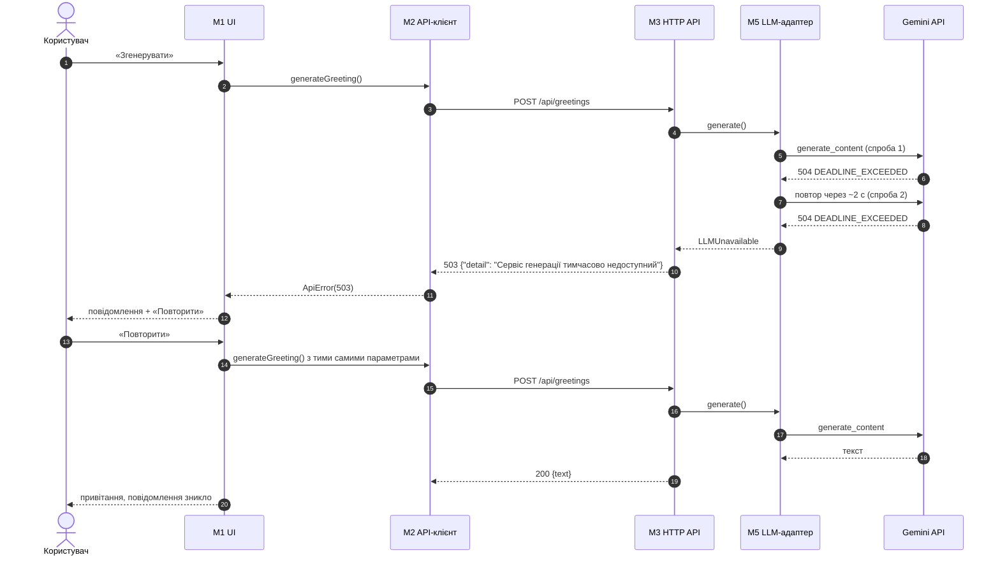

# План інтеграції

## Порядок інтеграції

Знизу вгору, щоб кожен крок перевірявся без зовнішнього API і без грошей:

| Крок | Що інтегруємо | Чим заміняємо відсутнє | Перевірка |
|---|---|---|---|
| 1 | Конфігурація + M4 Промпт | — | TC-11 |
| 2 | M5 LLM-адаптер із заглушкою (`MockGenerator`) | Gemini → заглушка | TC-16…TC-22 (фейковий клієнт) |
| 3 | M3 HTTP API + M5 | Gemini → заглушка | TC-01…TC-15 |
| 4 | M2 API-клієнт + M1 UI | бекенд → підмінений `fetch` | TC-23…TC-27 |
| 5 | Фронтенд + бекенд через проксі Vite | Gemini → `LLM_PROVIDER=mock` | ручний прохід UC-01 |
| 6 | Бекенд + справжній Gemini | — | TC-32…TC-34 |
| 7 | nginx + Docker Compose | — | `docker compose up`, `/api/health` |
| 8 (v0.3) | M6 Сховище + PostgreSQL | — | інтеграційні тести з тестовою БД |

## Сценарій 1. Успішна генерація

## Сценарій 2. Збій провайдера і повтор

Цей сценарій реально спостерігався 19.10.2026 ([test-report.md](../4-quality/test-report.md)).

## Стики модулів і можливі проблеми

| Стик | Ризик | Як захищено | Стан |
|---|---|---|---|
| M1 ↔ M2 | UI чекає поле `text`, а сервер змінить формат | спільний контракт [api.md](api.md); TC-25 | ✅ |
| M2 ↔ M3 (браузер ↔ сервер) | CORS-блокування; різні URL у dev і prod | у dev — проксі Vite, у prod — nginx на тому ж домені; `CORS_ORIGINS` у `.env`; TC-15 | ✅ |
| M2 ↔ M3: помилка валідації 422 | `detail` — масив, а не рядок; користувач бачить загальне повідомлення | BUG-05 | ⚠️ |
| M3 ↔ M5 | винятки провайдера «протікають» як 500 | адаптер перетворює все на `LLMBusy` / `LLMUnavailable` → 429 / 503; TC-12…TC-20 | ✅ |
| M5 ↔ Gemini: час | відповідь > 10 с або 504 | таймаут 15 с + 1 повтор; BUG-03 | ❌ NFR-1 |
| M5 ↔ Gemini: ліміти | 429 від безкоштовного тарифу | → 429 «спробуйте за хвилину»; TC-17 | ✅ |
| M5 ↔ Gemini: фільтр безпеки | `text = None` | → 503; з v0.2 — повторна генерація (FR-15) | ⚠️ |
| M5 ↔ Gemini: мова | імʼя в кличному відмінку («Сашо») ламає наївну перевірку | критерій FR-03 уточнено (CR-04) | ✅ |
| nginx ↔ M3 | nginx обірве довгий запит раніше за бекенд | `proxy_read_timeout 40s` > найгірший час бекенду (2 × 15 с + пауза) | ✅ |
| Воркери Uvicorn ↔ ліміт одночасних викликів | `Semaphore` у кожному процесі окремо: 2 воркери → 40 викликів | BUG-04 | ⚠️ |
| Конфігурація ↔ `.env` | немає ключа → незрозуміле падіння | явна помилка з посиланням на AI Studio при старті; TC-21 | ✅ |
