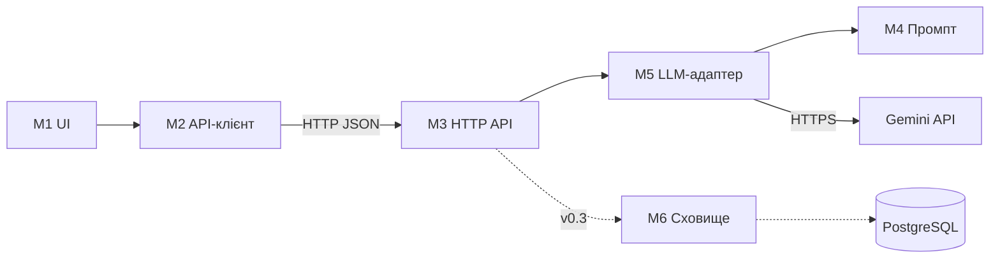

# Модулі й інтерфейси

## Модулі

| ID | Модуль | Файли | Відповідальність | Операції (інтерфейс) | Залежить від |
|---|---|---|---|---|---|
| M1 | UI | `frontend/src/App.jsx`, `App.css` | форма, стани «порожньо / завантаження / результат / помилка» | `handleGenerate()` — запустити генерацію; `render(state)` — показати стан; `selectStyle(id)` | M2 |
| M2 | API-клієнт | `frontend/src/api.js` | HTTP-запити до бекенду, переклад помилок у повідомлення | `generateGreeting({name, style}) → {text, style}`; кидає `ApiError(message, status)` | M3 (через HTTP) |
| M3 | HTTP API | `backend/app/main.py`, `schemas.py` | маршрути, валідація, CORS, ліміт одночасних викликів, перетворення помилок у 429/503 | `GET /api/health`; `POST /api/greetings`; `create_app(generator)` | M5, конфігурація |
| M4 | Промпт | `backend/app/prompts.py` | правила безпечного гумору, інструкції стилів | `build_user_prompt(name, style) → str`; `SYSTEM_PROMPT` | — |
| M5 | LLM-адаптер | `backend/app/llm.py` | виклик провайдера, таймаут і повтор, облік токенів | `generate(name, style) → str`; кидає `LLMBusy` / `LLMUnavailable`; `make_generator(settings)` | M4, Gemini API |
| M6 | Сховище (v0.3) | `backend/app/storage.py` (план) | запити, оцінки, лічильник на добу | `save_request(req) → id`; `save_rating(id, value)`; `count_today() → int` | PostgreSQL |

**Наскрізне:** `backend/app/config.py` — налаштування з `.env` (`Settings.model`, `cors_origin_list`), використовують M3 і M5.

## Залежності

Правила: залежності йдуть в один бік (зліва направо); M3 знає лише інтерфейс `GreetingGenerator`, а не конкретного провайдера; M1 не знає URL бекенду — їх знає тільки M2.

## Перевикористані компоненти

| Компонент | Версія | Навіщо |
|---|---|---|
| Python | 3.12 | мова бекенду |
| FastAPI | 0.146.0 | REST API, валідація, OpenAPI `/docs` |
| Starlette | 1.9.0 | основа FastAPI, CORS-middleware |
| Pydantic | 2.14.1 | схеми й валідація |
| pydantic-settings | 2.16.0 | конфігурація з `.env` |
| Uvicorn | 0.54.0 | ASGI-сервер |
| google-genai | 2.31.0 | SDK Gemini API |
| anthropic | 1.15.0 | SDK Claude API (опційний провайдер) |
| Gemini API, модель `gemini-3.8-flash` | — | генерація тексту, безкоштовний тариф |
| React | 19.3.1 | інтерфейс |
| Vite | 8.3.4 | збирання й dev-сервер із проксі |
| nginx | 1.27 | віддача статики, проксі `/api` |
| pytest / Vitest / Testing Library | 9.1.1 / 5.0.5 / 16.3.3 | автотести |
| Ruff / ESLint | 0.17.1 / 10.13.0 | лінтери |
| Docker, GitHub Actions | — | збирання й CI |
