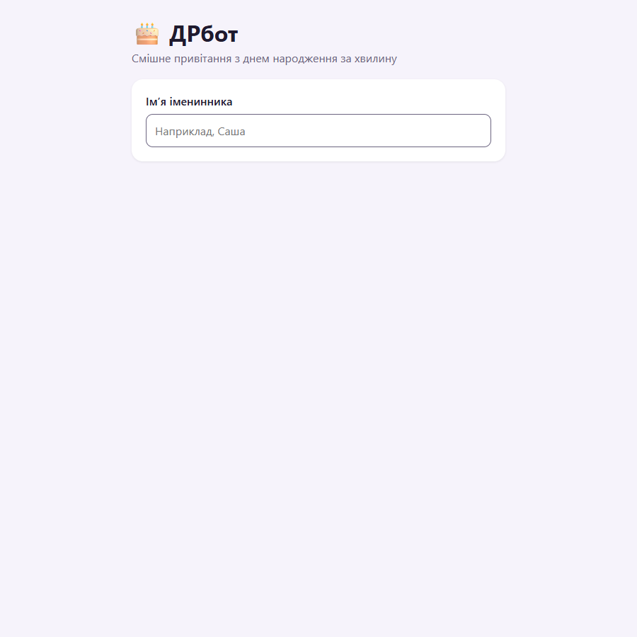
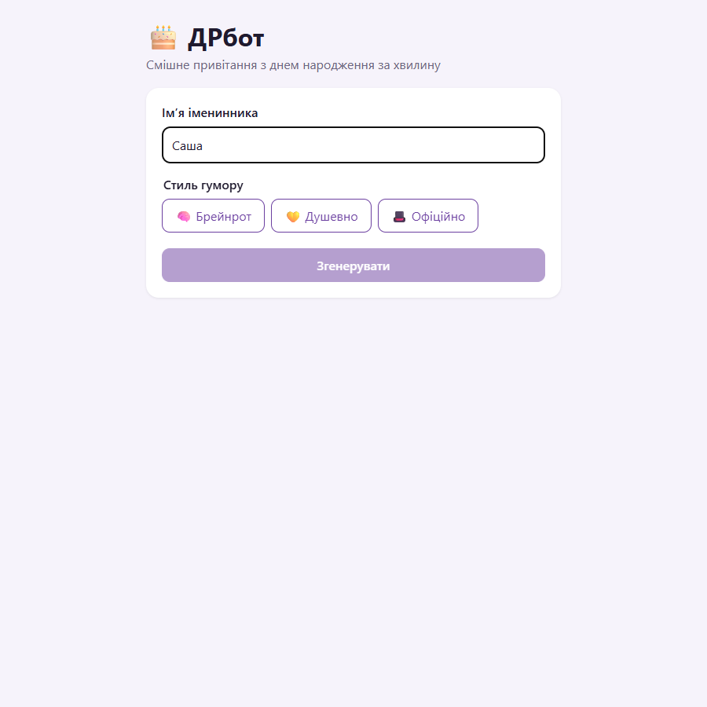
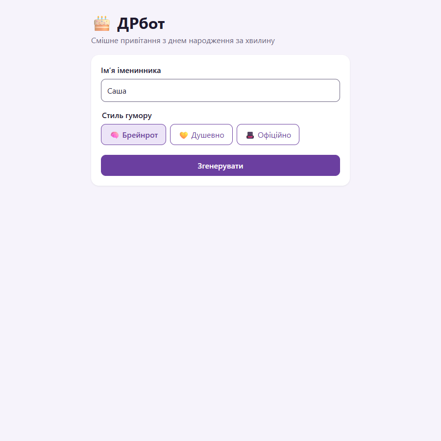
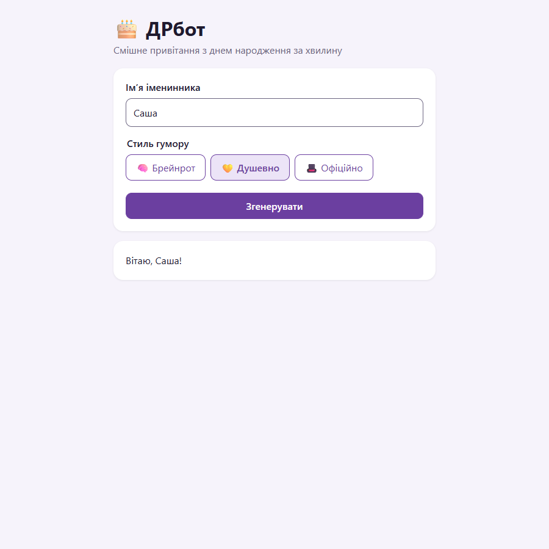
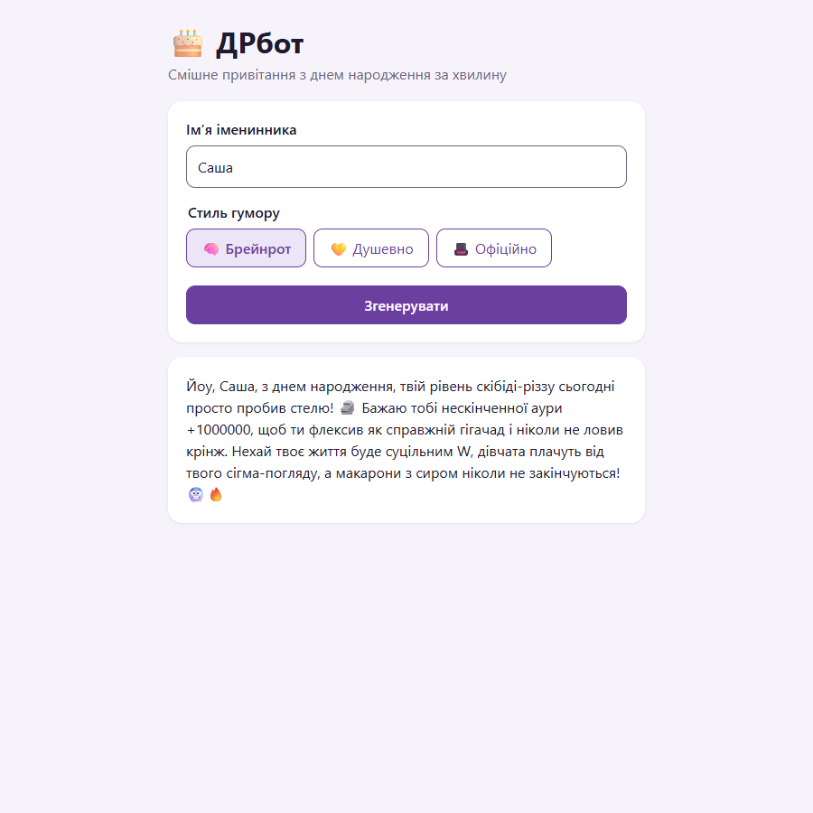
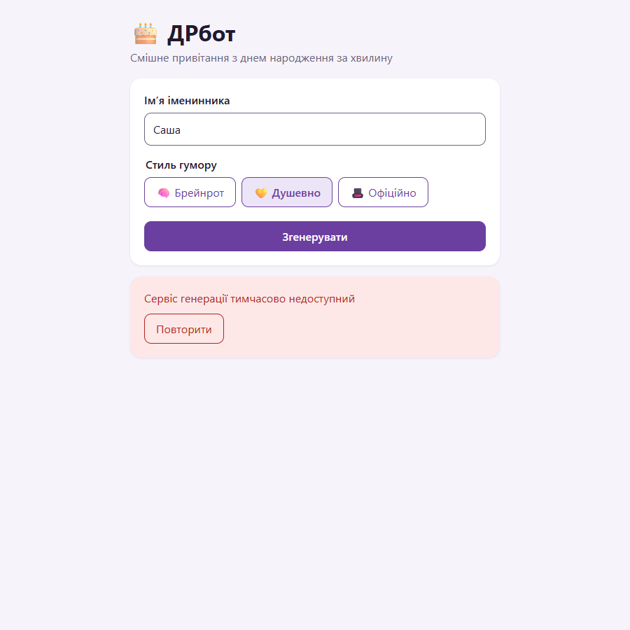
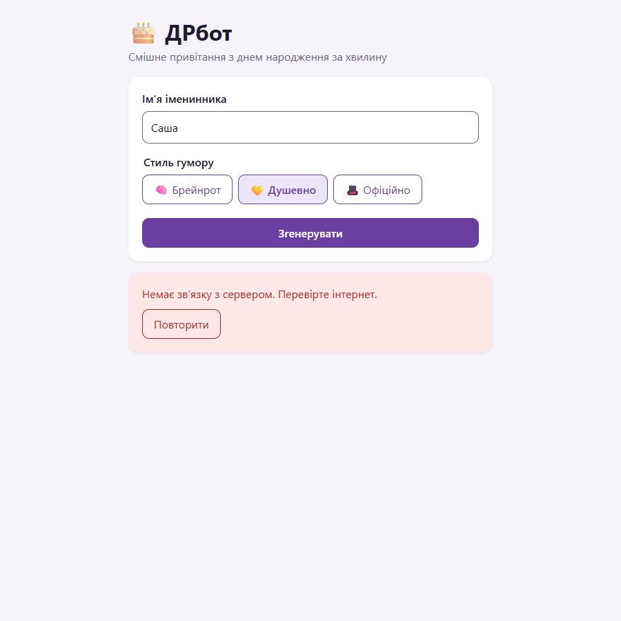
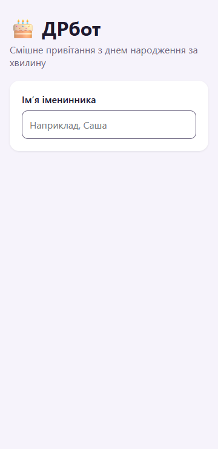
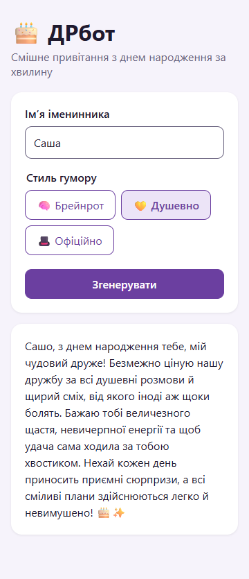

# Прототип

Прототип — це **робочий застосунок** із цього репозиторію (`frontend/` + `backend/`), а не макет. Як запустити — у [README](../../README.md#запуск). Скриншоти зняті автоматично 19.10.2026 у Microsoft Edge сценарієм [system_tests.py](../../4-quality/system-tests/system_tests.py); тексти привітань — справжні відповіді `gemini-3.8-flash`, помилки змодельовано підміною відповіді сервера.

## Головний шлях (UC-01)

| Крок | Екран | Що видно |
|---|---|---|
| 1. Порожній стан |  | лише поле імені |
| 2. Введено імʼя |  | 3 стилі, «Згенерувати» неактивна |
| 3. Обрано стиль |  | стиль виділено, кнопка активна |
| 4. Завантаження |  | «Генеруємо…», кнопка неактивна |
| 5. Результат |  | привітання в стилі «Брейнрот» |

## Помилки (альтернативні потоки)

| Ситуація | Екран | Що видно |
|---|---|---|
| LLM недоступний (503) |  | повідомлення + «Повторити» |
| Ліміт (429) |  | «зачекайте кілька секунд» + «Повторити» |
| Немає мережі |  | «Немає звʼязку з сервером…» + «Повторити» |

## Мобільний екран 360 px (NFR-7)

| Порожній стан | Результат |
|---|---|
|  |  |

## Порожні стани

- Немає імені → немає стилів і кнопки генерації (екран 1).
- Імʼя з одних пробілів → так само, як порожнє (TC-30).
- Ще не генерували → блоку результату немає (екрани 1–4).

Карта переходів між станами — у [user-flow.md](../user-flow.md).
