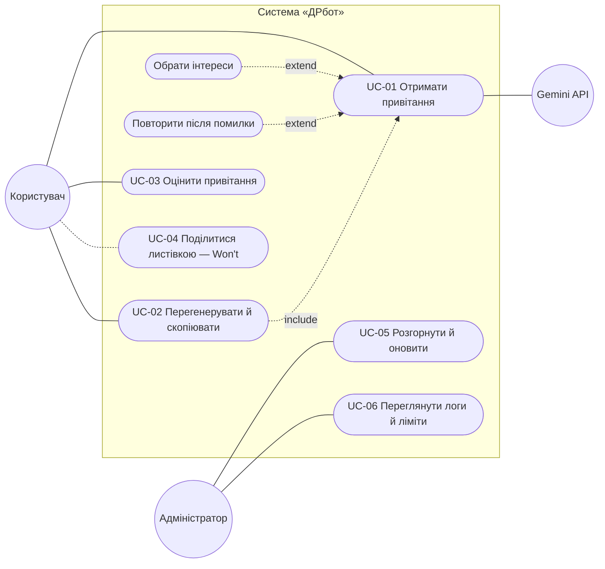

# Варіанти використання

## Діаграма

Mermaid не має окремого типу UML use case, тому діаграму подано flowchart-нотацією: актори — кола, варіанти використання — овали в межах системи.

| ID | Назва | Актор | Вимоги | Пріоритет |
|---|---|---|---|---|
| UC-01 | Отримати привітання | Користувач, Gemini API | FR-01–03, 05, 06, 09, 10, 15 | Must |
| UC-02 | Перегенерувати й скопіювати | Користувач | FR-04, FR-07 | Should |
| UC-03 | Оцінити привітання | Користувач | FR-14 | Should |
| UC-04 | Поділитися листівкою | Користувач | FR-08 | Won't |
| UC-05 | Розгорнути й оновити | Адміністратор | — | Must для релізу |
| UC-06 | Переглянути логи й ліміти | Адміністратор | NFR-2 | Should |

## UC-01. Отримати привітання

| | |
|---|---|
| **Актор** | Користувач; другорядний — Gemini API |
| **Передумови** | Фронтенд і бекенд розгорнуто; у бекенді задано `GEMINI_API_KEY` |
| **Постумова (успіх)** | Користувач бачить текст привітання; з v0.3 параметри запиту збережено в БД для статистики |
| **Тригер** | Користувач відкрив сайт |

### Основний потік

1. Користувач відкриває сайт; система показує поле «Імʼя іменинника».
2. Користувач вводить імʼя; система показує 3 стилі й неактивну «Згенерувати».
3. Користувач обирає стиль; кнопка стає активною.
   - 3а. (v0.2) Користувач обирає до 3 інтересів.
4. Користувач натискає «Згенерувати»; кнопка показує «Генеруємо…».
5. React надсилає `POST /api/greetings`; FastAPI будує промпт і викликає Gemini.
6. Система показує привітання; користувач копіює його.

### Альтернативні потоки

- **5а. LLM недоступний або немає мережі.** Бекенд повертає 503 (або запит не доходить); сторінка показує повідомлення й «Повторити». Після натискання — повернення до кроку 5.
- **5б. Фільтр безпеки заблокував текст.** (v0.2, FR-15) Бекенд генерує ще раз, не повертаючи заблокований варіант. Якщо й друга спроба заблокована — потік 5а.
- **5в. Перевищено ліміт.** Бекенд повертає 429; сторінка показує «зачекайте…» і (v0.2) таймер, після якого активна «Повторити».
- **2а. Імʼя з одних пробілів.** Стилі не показуються; користувач лишається на кроці 2.

## UC-02. Перегенерувати й скопіювати

| | |
|---|---|
| **Актор** | Користувач |
| **Передумови** | Виконано UC-01, на сторінці є привітання |
| **Постумова** | Текст, що сподобався, у буфері обміну |

### Основний потік

1. Користувач читає привітання; воно не підходить.
2. Користувач натискає «Перегенерувати».
3. Система виконує кроки 4–6 UC-01 з тими самими параметрами й показує новий текст.
4. Користувач натискає «Копіювати»; кнопка на 2 с показує «Скопійовано ✓».

### Альтернативні потоки

- **2а. Помилка генерації.** Як 5а–5в в UC-01; попереднє привітання лишається на сторінці.
- **4а. Браузер заборонив доступ до буфера.** Система показує «Не вдалося скопіювати — виділіть текст вручну» і виділяє текст.

## UC-03. Оцінити привітання

| | |
|---|---|
| **Актор** | Користувач |
| **Передумови** | На сторінці є привітання; БД доступна (v0.3) |
| **Постумова** | Оцінка збережена без тексту привітання |

### Основний потік

1. Користувач натискає 👍 або 👎 під привітанням.
2. Фронтенд надсилає `POST /api/greetings/{id}/rating`.
3. Система зберігає оцінку зі стилем і моделлю; кнопка підсвічується.

### Альтернативні потоки

- **1а. Користувач змінює думку.** Нова оцінка замінює попередню.
- **2а. Сервер недоступний.** Оцінка не зберігається, показується ненавʼязлива підказка «Не вдалося зберегти оцінку»; основний сценарій не блокується.
