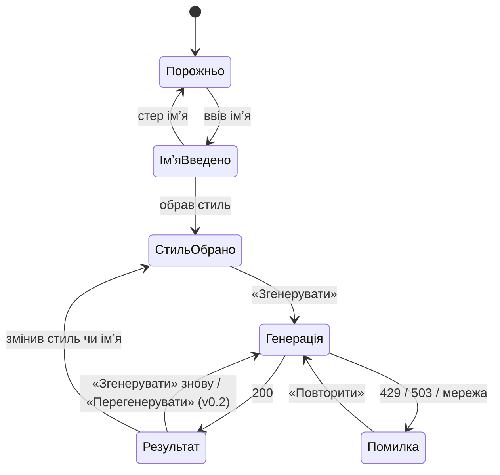
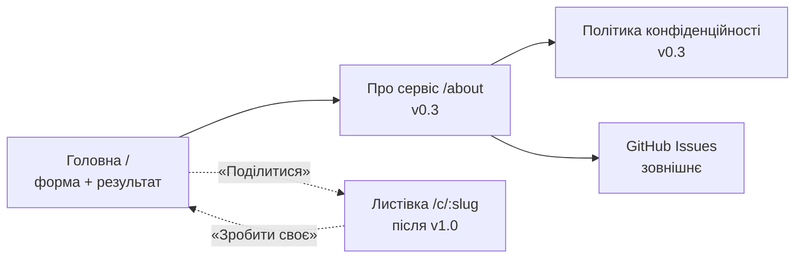

# Карта екранів і переходів

У MVP один екран зі станами; з v0.3 додається сторінка «Про сервіс», після v1.0 — сторінка-листівка.

## Стани головного екрана

## Карта сторінок

Скриншоти станів — у [prototype/](prototype/README.md).
