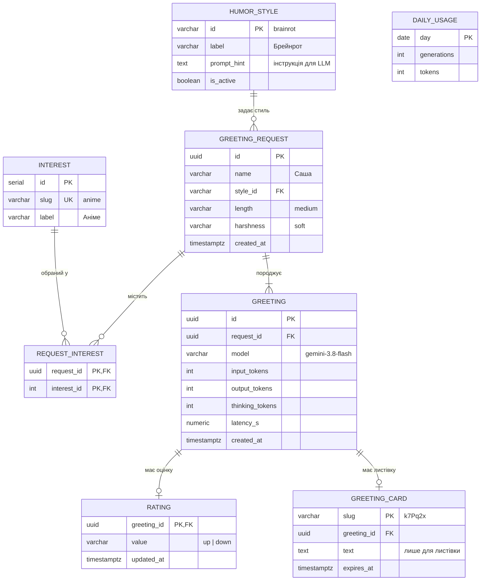

# Модель даних

> MVP (v0.1.0) **нічого не зберігає** ([ADR-0003](../2-architecture/adr/0003-no-database-in-mvp.md)). Нижче — модель для v0.3+ (інтереси — з v0.2, решта — з v0.3), спроєктована заздалегідь, щоб не ламати API.

## ER-діаграма

`DAILY_USAGE` не повʼязана зовнішніми ключами: це агрегат, який оновлюється при кожній генерації й перевіряється перед викликом LLM (NFR-2).

## Словник даних

| Сутність | Поле | Тип | Обовʼязкове | Приклад | Примітка |
|---|---|---|---|---|---|
| HUMOR_STYLE | id | varchar(20) | так | `brainrot` | ключ, збігається з API |
| HUMOR_STYLE | label | varchar(40) | так | `Брейнрот` | |
| HUMOR_STYLE | prompt_hint | text | так | `Стиль «брейнрот»: абсурдний…` | |
| HUMOR_STYLE | is_active | boolean | так | `true` | вимкнути стиль без видалення |
| INTEREST | id | serial | так | `3` | |
| INTEREST | slug | varchar(30), унікальне | так | `anime` | |
| INTEREST | label | varchar(40) | так | `Аніме` | |
| GREETING_REQUEST | id | uuid | так | `3f2b…` | |
| GREETING_REQUEST | name | varchar(50) | так | `Саша` | персональні дані, видаляються через 30 днів |
| GREETING_REQUEST | style_id | varchar(20), FK | так | `warm` | |
| GREETING_REQUEST | length | varchar(10) | ні | `medium` | FR-11 |
| GREETING_REQUEST | harshness | varchar(10) | ні | `soft` | FR-12 |
| GREETING_REQUEST | created_at | timestamptz | так | `2026-10-19T20:41:00Z` | |
| REQUEST_INTEREST | request_id, interest_id | uuid, int | так | | 0–3 рядки на запит |
| GREETING | id | uuid | так | | повертається в API з v0.3 |
| GREETING | model | varchar(50) | так | `gemini-3.8-flash` | для порівняння моделей |
| GREETING | input_tokens, output_tokens, thinking_tokens | int | ні | `229`, `140`, `—` | NFR-2 |
| GREETING | latency_s | numeric(5,2) | так | `4.97` | NFR-1 |
| RATING | value | varchar(4) | так | `up` | FR-14 |
| GREETING_CARD | slug | varchar(8) | так | `k7Pq2x` | після v1.0 |
| GREETING_CARD | text | text | так | | єдине місце, де зберігається текст привітання |
| GREETING_CARD | expires_at | timestamptz | так | | +30 днів |
| DAILY_USAGE | day | date | так | `2026-10-19` | |
| DAILY_USAGE | generations | int | так | `212` | ліміт 500 |

**Свідомо не зберігаємо:** текст привітання (крім листівки), IP-адреси, дані про браузер, контакти.

## Де й як зберігаються дані

| Дані | Де | Скільки | Хто має доступ |
|---|---|---|---|
| Запити, оцінки, лічильники (v0.3+) | PostgreSQL у Docker-томі на VPS | запити — 30 днів, агрегати — безстроково | адміністратор |
| Логи (час, токени, стиль) | stdout контейнера | 14 днів (ротація Docker) | адміністратор |
| Ключі API | `backend/.env` на сервері | — | адміністратор; не в git |

## Зовнішні сервіси

| Сервіс | Що отримує | Навіщо |
|---|---|---|
| Gemini API (Google) | імʼя, стиль, (v0.2) інтереси — у тексті промпту | генерація; на безкоштовному тарифі Google може використовувати запити для покращення моделей ([privacy.md](../5-management/privacy.md)) |
| GitHub (Issues) | що користувач сам напише | зворотний звʼязок |
