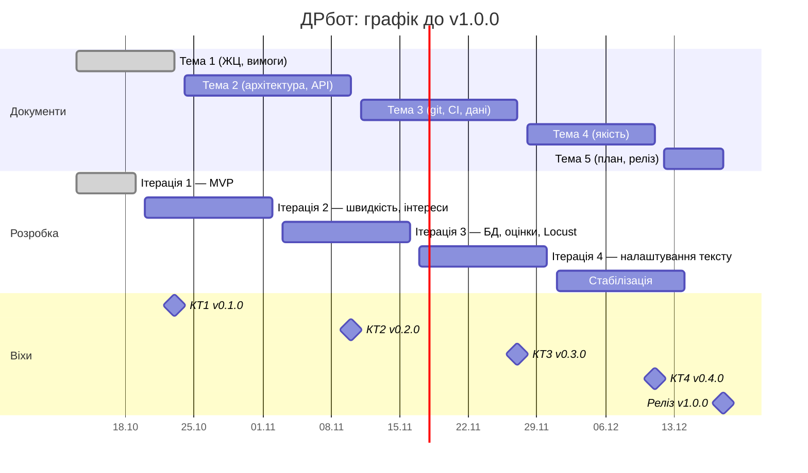

# План реалізації

> Дати орієнтовні: розраховано з припущення «2 практичні на тиждень з 13.10.2026». Уточніть за розкладом групи.

## Декомпозиція робіт (WBS)

```mermaid
flowchart TB
    P[ДРбот v1.0.0]
    P --> W1[1 Продукт і вимоги]
    P --> W2[2 Архітектура]
    P --> W3[3 Реалізація]
    P --> W4[4 Якість]
    P --> W5[5 Реліз і супровід]

    W1 --> W11[1.1 Vision, персони, конкуренти]
    W1 --> W12[1.2 SRS, MVP, трасування]
    W1 --> W13[1.3 Процес, беклог, план ітерації]

    W2 --> W21[2.1 Use case, класи]
    W2 --> W22[2.2 Архітектура, ADR, модулі]
    W2 --> W23[2.3 API, план інтеграції, прототип]

    W3 --> W31[3.1 MVP: форма, генерація, помилки]
    W3 --> W32[3.2 Інкремент 2: інтереси, перегенерація, швидкість]
    W3 --> W33[3.3 Інкремент 3: БД, оцінки, копіювання]
    W3 --> W34[3.4 Інкремент 4: довжина, «жорсткість»]
    W3 --> W35[3.5 CI, Docker, git-процес]

    W4 --> W41[4.1 Тест-план і кейси]
    W4 --> W42[4.2 Автотести й системні тести]
    W4 --> W43[4.3 Навантажувальний тест, ревʼю NFR-5]
    W4 --> W44[4.4 Ревʼю документів, баг-репорти]

    W5 --> W51[5.1 Розгортання на VPS]
    W5 --> W52[5.2 Інструкція, супровід, реліз-план]
    W5 --> W53[5.3 GitHub Release v1.0.0]
```

## Оцінка трудомісткості

Розробка — у story points (беклог, [backlog.md](../1-lifecycle/backlog.md)); великі пакети без досвіду — PERT: `E = (O + 4M + P) / 6`, години.

| Пакет | SP | O, год | M, год | P, год | E (PERT), год | Стан |
|---|---|---|---|---|---|---|
| 3.1 MVP | 19 | — | — | — | — | ✅ готово |
| 3.2 Інкремент 2 | 21 | — | — | — | — | ітерація 2 |
| 3.3 Інкремент 3 (БД, оцінки, Locust, копіювання) | 24 | — | — | — | — | ітерація 3 |
| 3.4 Інкремент 4 (без VPS) | 7 | — | — | — | — | ітерація 4 |
| Перехід на PostgreSQL + Alembic | (у 3.3: 8) | 6 | 12 | 24 | 13 | |
| Виправлення NFR-1 (BUG-03) | (у 3.2: 3) | 2 | 6 | 16 | 7 | |
| Навантажувальний тест Locust | (у 3.3: 3) | 3 | 6 | 12 | 6,5 | |
| Розгортання на VPS | 3 | 2 | 5 | 12 | 5,7 | |
| Документація (усі теми) | — | 30 | 45 | 70 | 46,7 | більшість готова |

**MVP:** 19 SP — фактично закрито за ітерацію 1. **Решта до v1.0.0:** 21 + 24 + 7 + 3 (VPS) = 55 SP ≈ 3 ітерації при швидкості ~20 SP — укладаємося в семестр із запасом на стабілізацію.

## Графік і віхи

| Віха | Дата | Критерій |
|---|---|---|
| КТ1 · v0.1.0 | 23.10.2026 | вимоги перевіряємі, межа MVP проведена; MVP працює |
| КТ2 · v0.2.0 | 10.11.2026 | прототип проходить головний сценарій; NFR-1 виконується |
| КТ3 · v0.3.0 | 27.11.2026 | перевірка в GitHub Actions зелена на `main`; БД і оцінки |
| КТ4 · v0.4.0 | 11.12.2026 | кожна Must-вимога покрита тест-кейсом; Locust пройдено |
| v1.0.0 | 18.12.2026 | GitHub Release, інструкція, план супроводу |
