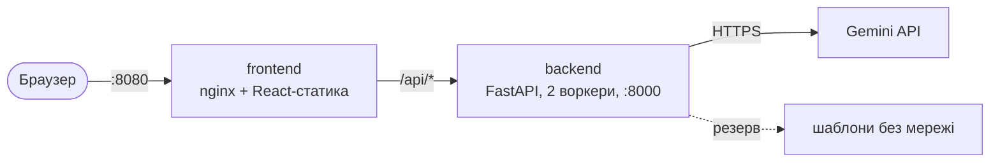

# Runbook: як підняти й обслуговувати ДРбот

Для розробника чи адміністратора, який бачить проєкт уперше. Усе, що треба, щоб запустити продукт, викласти на сервер, керувати ключами й доступами та розібратися зі збоєм. Черговий — Марк Паскалов (DevOps), див. [support.md](support.md).

## 1. Як влаштований продукт на сервері



- Два контейнери з [docker-compose.yml](../docker-compose.yml): `frontend` (nginx) і `backend` (FastAPI).
- Назовні відкритий **лише порт 8080**: nginx віддає сайт і сам проксіює `/api/*` на бекенд. Порт 8000 бекенду назовні не виходить.
- nginx чекає відповідь бекенду до 40 с (`proxy_read_timeout` у [frontend/nginx.conf](../frontend/nginx.conf)).
- Ключ API живе **лише** в `backend/.env` на сервері. У браузер, git і Docker-образ він не потрапляє.

## 2. Запуск локально (розробка)

Потрібні Python 3.12, Node 24, git.

```bash
git clone https://github.com/Marchello-Projects/Grat.git && cd Grat

# бекенд
cd backend
python -m venv .venv
.venv/Scripts/activate            # Windows; Linux/macOS: source .venv/bin/activate
pip install -r requirements-dev.txt
cp .env.example .env              # вписати GEMINI_API_KEY (розділ 4)
uvicorn app.main:app --reload     # http://localhost:8000/docs

# фронтенд — у другому терміналі
cd frontend && npm install && npm run dev   # http://localhost:5173
```

Без ключа й мережі:

- сайт — `LLM_PROVIDER=mock` у `backend/.env`;
- консоль — `LLM_PROVIDER=templates`, потім `python -m app.cli Саша --style warm`.

Перевірка перед комітом — те саме, що робить CI:

```bash
cd backend && ruff check . && ruff format --check . && pytest -q
cd frontend && npm run lint && npm test
```

## 3. Розгортання на сервері

### 3.1. Що потрібно

| Що | Мінімум |
|---|---|
| Сервер | VPS 1–2 vCPU, 2 ГБ RAM, 10 ГБ диска; Ubuntu 24.04 LTS (або інший Linux із Docker) |
| Мережа | відкритий вхідний порт 8080 (або 80/443, див. 3.5) |
| Софт | Docker Engine + плагін Compose, git |
| Доступи | SSH-ключ до сервера, право читати репозиторій, ключ Gemini (розділ 4) |

### 3.2. Підготовка сервера (один раз)

```bash
ssh deploy@<IP-сервера>
curl -fsSL https://get.docker.com | sh       # офіційний скрипт встановлення Docker
sudo usermod -aG docker $USER && exit        # перелогінитись, щоб docker працював без sudo
ssh deploy@<IP-сервера>
docker compose version                        # має показати версію
git clone https://github.com/Marchello-Projects/Grat.git ~/drbot
```

### 3.3. Перший запуск

```bash
cd ~/drbot
cp backend/.env.example backend/.env
nano backend/.env          # GEMINI_API_KEY, CORS_ORIGINS=http://<IP-сервера>:8080
chmod 600 backend/.env     # читати файл з ключем може лише власник
docker compose up -d --build
```

Рекомендовані значення в `backend/.env` для сервера:

```text
LLM_PROVIDER=gemini
GEMINI_API_KEY=<ключ>
LLM_FALLBACKS=gemini:gemini-3.5-flash-lite,templates
LLM_TIMEOUT_S=10
LLM_MAX_RETRIES=0
LLM_MAX_CONCURRENCY=20
CORS_ORIGINS=http://<IP-сервера>:8080
```

Резерв (`LLM_FALLBACKS`) обовʼязковий: без нього, коли Gemini перевантажена, сайт не видає жодного привітання (BUG-10, [ADR-0005](../2-architecture/adr/0005-fallback-llm.md)). Таймаут менший за 10 с Gemini не приймає.

### 3.4. Перевірка, що все працює

```bash
docker compose ps                                  # обидва контейнери Up, backend — (healthy)
curl -s http://localhost:8080/api/health           # {"status":"ok"}
docker compose logs --tail=50 backend              # без Traceback
```

Потім із телефона: `http://<IP-сервера>:8080` → «Саша» → стиль → «Згенерувати». Привітання є — запуск успішний. У лозі бекенду має бути рядок `greeting generated` або `fallback: відповів …`.

### 3.5. Домен і HTTPS

**Ще не налаштовано** (план — до v1.0.0, [release-plan.md](release-plan.md)). Найпростіший шлях: перед контейнерами поставити Caddy, який сам отримує сертифікат Let's Encrypt і проксіює домен на `localhost:8080`. Після цього змінити `CORS_ORIGINS=https://<домен>`.

## 4. Ключі

| Ключ | Де отримати | Де зберігається | Хто має доступ |
|---|---|---|---|
| `GEMINI_API_KEY` | <https://aistudio.google.com/apikey> → **Create API key**, картка не потрібна | `backend/.env` на сервері і в розробника; ніколи в git | Марк (власник акаунта Google AI Studio проєкту) |
| `ANTHROPIC_API_KEY` | console.anthropic.com, платно | там само; зараз не використовується | — |

**Ліміти безкоштовного тарифу Gemini** (перевірено щоденним прогоном): **20 запитів на добу і 5 на хвилину** на кожну модель. Невдалі виклики теж рахуються. Тому резерв іде на іншу модель (`flash-lite`) — у неї свій окремий ліміт.

### Заміна ключа (планова, без простою)

```bash
# 1. Створити новий ключ в AI Studio
nano backend/.env                     # 2. Вписати новий GEMINI_API_KEY
docker compose up -d backend          # 3. Перезапустити лише бекенд, без перезбирання
curl -s http://localhost:8080/api/health
# 4. Перевірити генерацію з телефона, потім видалити старий ключ в AI Studio
```

### Якщо ключ витік (інцидент P1)

Ключ потрапив у git, скриншот, чат чи лог:

1. **Одразу** видалити ключ в AI Studio. Самого видалення з історії git недостатньо: ключ уже могли скопіювати.
2. Створити новий ключ і замінити його за кроками вище.
3. Якщо ключ був у git — переписати історію або вважати репозиторій скомпрометованим, і повідомити команду.
4. Записати інцидент у GitHub Issues: що, коли, як потрапив, що зроблено ([support.md](support.md), P1).

## 5. Доступи

> **Стан на 08.11.2026:** сервер ще не орендовано (ризик R-10 у [risks.md](risks.md), розгортання — до v1.0.0). Рядки про сервер описують, як має бути з першого дня. Решта — вже діє.

| Ресурс | Хто має | Рівень | Як видати | Як відкликати |
|---|---|---|---|---|
| Репозиторій GitHub | Аліна, Марк, Макс | Write; злиття в `main` лише через PR з ревʼю | Settings → Collaborators → Add people | там само → Remove |
| Сервер (SSH) | Марк; запасний — Макс | користувач `deploy` у групі `docker` | додати публічний ключ людини в `~/.ssh/authorized_keys` | видалити її рядок з `authorized_keys` |
| `backend/.env` на сервері | лише користувач `deploy` | `chmod 600` | — | — |
| Акаунт Google AI Studio | Марк | власник ключа | ключ не передаємо в чат — лише вписуємо на сервері | видалити ключ, створити новий |
| GitHub Actions | автоматично | CI працює з `LLM_PROVIDER=mock` і **ключа не потребує** | — | — |

Правила:

- **Паролі на SSH вимкнено**, вхід лише за ключем.
- **Root по SSH не використовуємо**: працюємо як `deploy`.
- **Людина йде з команди** — того ж дня видаляємо її SSH-ключ і доступ до репозиторію, а ключ Gemini замінюємо, якщо вона його бачила.
- **Запасний доступ.** Макс має SSH, щоб сервер не тримався на одній людині ([практична 3](../practicals/03-roles-raci.md), bus factor).

## 6. Щоденні дії

| Що | Команда |
|---|---|
| Стан контейнерів | `docker compose ps` |
| Логи бекенду наживо | `docker compose logs -f backend` |
| Які моделі відповідали за день | `docker compose logs backend \| grep -E "greeting generated\|fallback"` |
| Перезапустити бекенд (після зміни `.env`) | `docker compose up -d backend` |
| Оновити до нової версії | `git fetch --tags && git checkout v<версія> && docker compose up -d --build` |
| Відкотити на попередню версію | `git checkout v<попередня> && docker compose up -d --build` |
| Зупинити все | `docker compose down` |

Повний порядок релізу й плану відкату — у [release-plan.md](release-plan.md).

## 7. Типові проблеми

| Що бачить користувач або лог | Причина | Що робити |
|---|---|---|
| «Сервіс генерації зараз перевантажений, спробуйте за хвилину» (429) | вичерпано ліміт Gemini: 20 на добу або 5 на хвилину | перевірити, що в `.env` є `LLM_FALLBACKS` з `templates` — тоді користувач отримає привітання з резерву. Добовий ліміт скидається раз на добу |
| «Сервіс генерації тимчасово недоступний» (503) | Gemini перевантажена (`504`/`503` у лозі) або всі ланки резерву впали | `docker compose logs backend \| grep fallback`; якщо резерву немає — додати `LLM_FALLBACKS` |
| у лозі `400 … Minimum allowed deadline is 10s` | `LLM_TIMEOUT_S` менше за 10 | поставити `LLM_TIMEOUT_S=10` |
| у лозі `400 … unexpected model name format` | помилка в `LLM_MODEL`, напр. `LLM_MODEL=LLM_MODEL=…` | виправити рядок у `.env`, перезапустити бекенд |
| усі відповіді — шаблонні, хоча Gemini працює | ключ зламаний або прострочений: резерв **ховає** помилку налаштування | шукати в лозі `fallback: gemini… не відповів` з причиною; перевірити ключ |
| сайт показує «Not Found» замість привітання | **локально**: порт 8000 зайнятий іншим процесом чи Docker-контейнером, і Vite проксіює `/api` не туди | `netstat -ano \| findstr :8000` (Windows); зупинити чужий процес або контейнер (`docker stop <імʼя>`) |
| `docker compose up` падає з `Невідомий LLM_PROVIDER` | помилка в `LLM_PROVIDER` | допустимі: `gemini`, `anthropic`, `mock`, `templates` |
| бекенд не `healthy` | помилка під час старту — найчастіше `.env` | `docker compose logs backend` — перші рядки після старту |

Не знайшли свою проблему — Issue за [шаблоном дефекту](../.github/ISSUE_TEMPLATE/bug_report.md), а після розвʼязання додайте рядок у цю таблицю.
