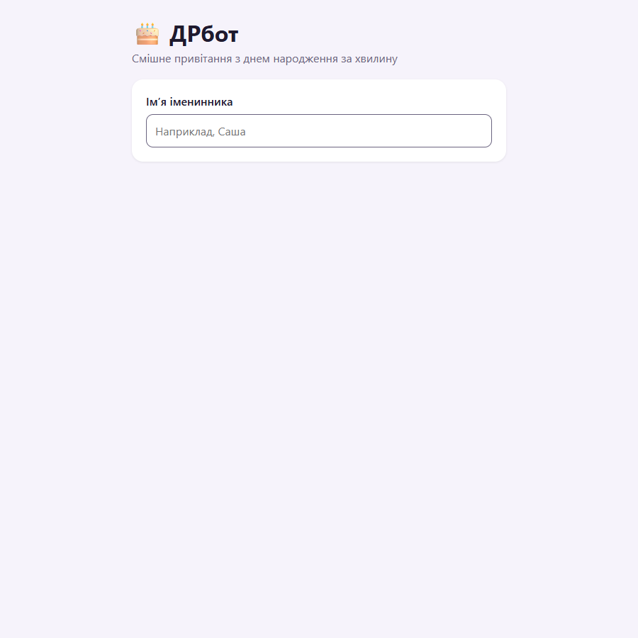
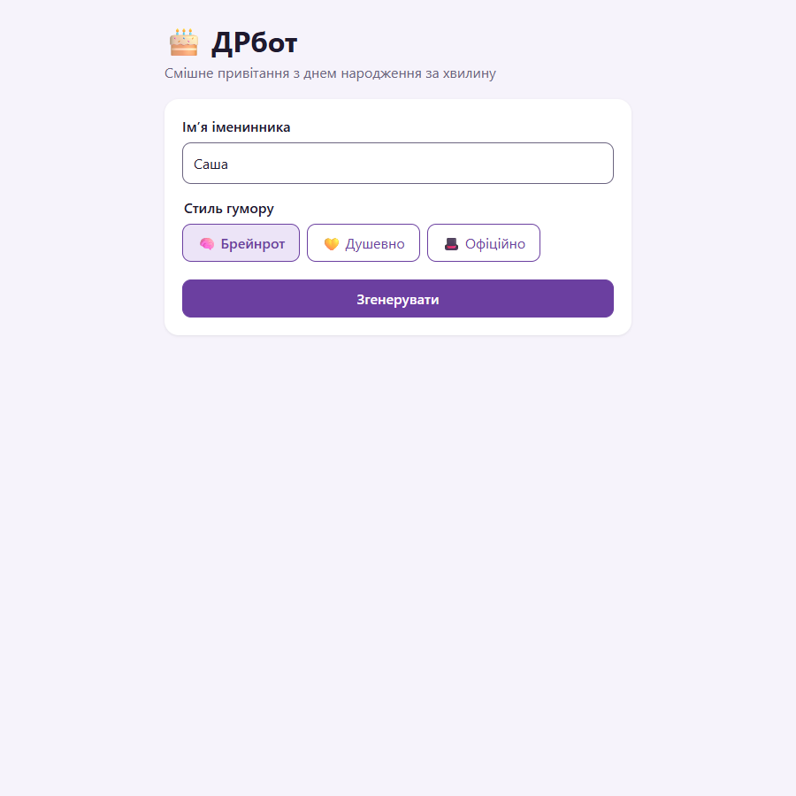
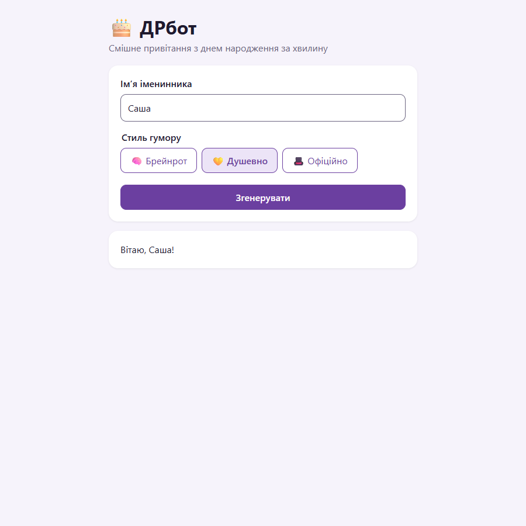
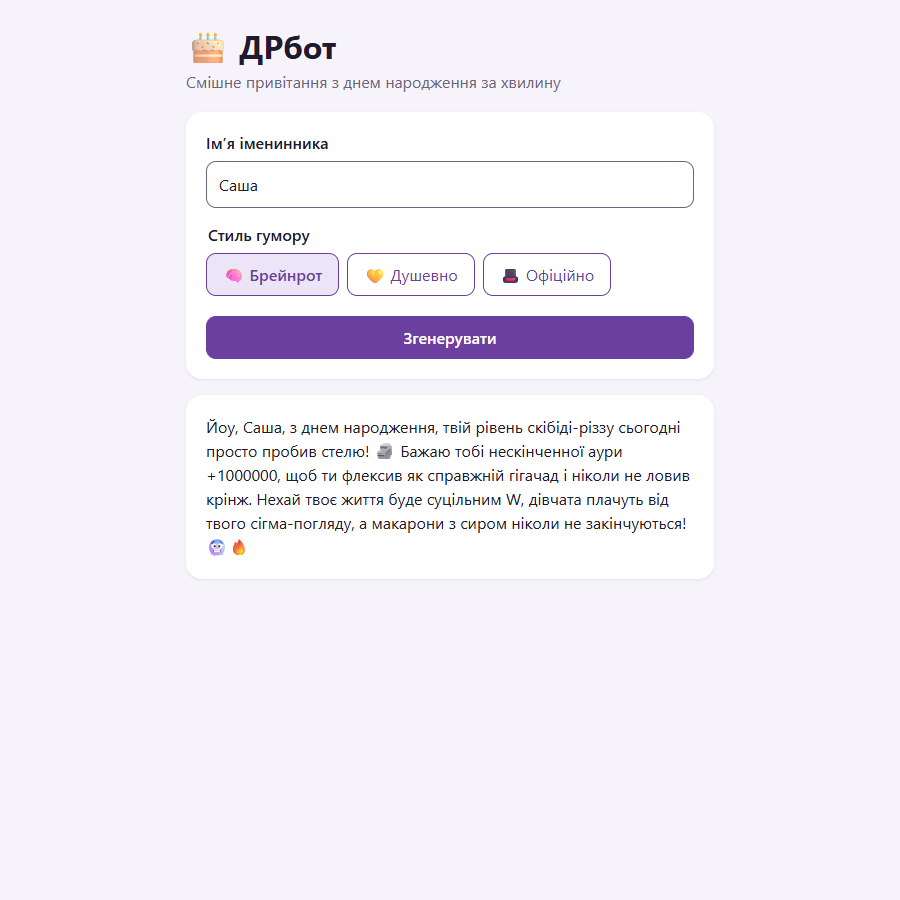
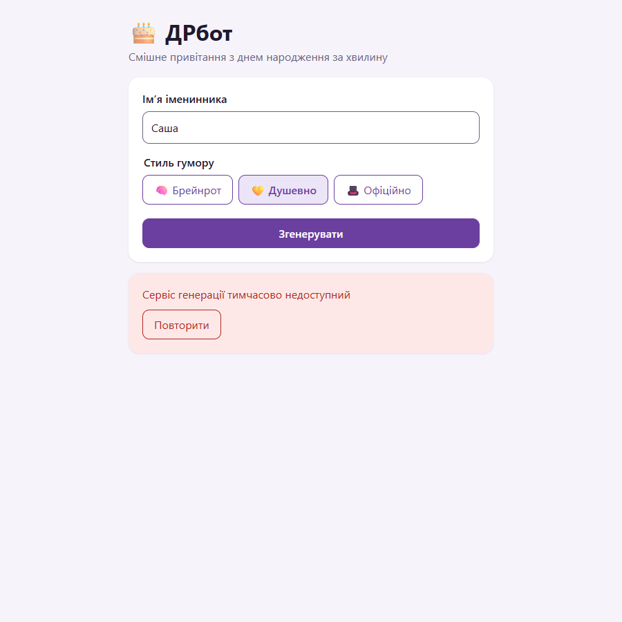
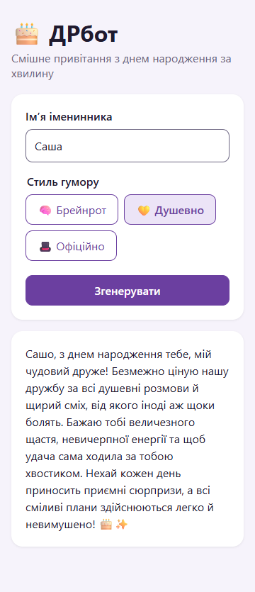

# Інструкція користувача

> Для версії 0.1.0. Скриншоти — з [prototype/](../2-architecture/prototype/README.md).

## Що це

**ДРбот** пише смішне привітання з днем народження українською за хвилину. Ви вводите імʼя друга, обираєте стиль гумору — і отримуєте текст, який можна скопіювати в Telegram, Viber чи Instagram.

Нічого встановлювати й реєструватися не треба: відкрийте сайт у браузері на телефоні чи компʼютері.

## Як отримати привітання

### Крок 1. Введіть імʼя

Відкрийте сайт. Ви побачите одне поле — «Імʼя іменинника». Введіть імʼя так, як звертаєтесь до людини: «Саша», «Олена Петрівна», «Макс».

- До 50 символів.
- Апостроф, дефіс і пробіли всередині можна: «Мар'яна», «Анна-Марія».

### Крок 2. Оберіть стиль

Щойно ви ввели імʼя, зʼявляться три стилі:

| Стиль | Кому підходить | Яким буде текст |
|---|---|---|
| 🧠 **Брейнрот** | друзям, однолітками | абсурдний інтернет-гумор: «сігма», «аура +1000», «скібіді», емодзі |
| 💛 **Душевно** | близьким людям | тепло й щиро, з легким гумором |
| 🎩 **Офіційно** | колегам, викладачам, «від колективу» | урочисто й ввічливо, без сленгу |

Обраний стиль підсвічується, кнопка «Згенерувати» стає активною.

### Крок 3. Натисніть «Згенерувати»

Кнопка покаже «Генеруємо…» — зачекайте кілька секунд, повторно натискати не треба.

### Крок 4. Скопіюйте й надішліть

Привітання зʼявиться під формою. Виділіть текст і скопіюйте (на телефоні — довге натискання → «Копіювати»). Кнопка «Копіювати» зʼявиться у версії 0.3.

Не сподобалось? Натисніть «Згенерувати» ще раз — щоразу текст новий. Можна змінити стиль.

## Якщо щось пішло не так

| Що бачите | Що це означає | Що робити |
|---|---|---|
| «Сервіс генерації тимчасово недоступний» | сервіс ШІ не відповів вчасно | натисніть «Повторити»; якщо не допомагає — спробуйте за кілька хвилин |
| «Забагато запитів, зачекайте кілька секунд» | зараз багато людей генерують одночасно | зачекайте 5–10 секунд і натисніть «Повторити» |
| «Сервіс генерації зараз перевантажений, спробуйте за хвилину» | вичерпано ліміт безкоштовного сервісу ШІ | зачекайте хвилину; увечері ліміт може закінчитися на весь день |
| «Немає звʼязку з сервером. Перевірте інтернет.» | телефон чи компʼютер офлайн або сайт недоступний | перевірте інтернет і натисніть «Повторити» |
| Немає кнопок стилю | поле імені порожнє або лише з пробілів | введіть імʼя |

## На телефоні

Сайт працює на екранах від 360 px у сучасних браузерах (Chrome, Safari, Firefox, Edge). Кнопки стилів переносяться на другий рядок — це нормально.

## Часті питання

**Це безкоштовно?**
Так. Сервіс використовує безкоштовний тариф Google Gemini.

**Ви зберігаєте імена й привітання?**
У версії 0.1 — ні, нічого не зберігається. Але імʼя передається в сервіс Google Gemini для генерації, і на безкоштовному тарифі Google може використовувати запити для покращення моделей. Тому вводьте лише імʼя, без прізвищ, телефонів та інших даних. Детальніше — у [політиці конфіденційності](privacy.md).

**Чому імʼя в тексті змінилося — «Сашо» замість «Саша»?**
Це кличний відмінок — граматично правильне звертання українською.

**Чому відповідь іноді йде довго?**
Час відповіді залежить від сервісу ШІ: зазвичай 2–10 секунд, увечері буває довше. Ми працюємо над пришвидшенням.

**Привітання вийшло образливим. Що робити?**
Не надсилайте його, згенеруйте нове й повідомте нам ([див. «Підтримка»](#підтримка)). Сервіс має правила проти образ, але ШІ іноді помиляється.

**Можна отримати привітання англійською?**
Поки ні — це в планах після версії 1.0.

**Можна обрати, що любить друг (ігри, аніме)?**
Зʼявиться у версії 0.2.

## Підтримка

Помилки й пропозиції — у GitHub Issues репозиторію проєкту, шаблон «Дефект» (посилання додати після публікації репозиторію). Як ми обробляємо звернення — у [support.md](support.md).
